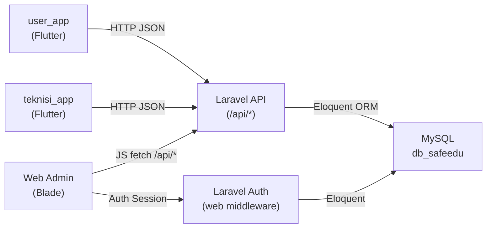

# 🔍 SafeEdu — Comprehensive Codebase Audit & Optimization Plan

**Auditor:** Senior Software Engineer / Architect / Code Quality Auditor
**Date:** 2026-11-15
**Mode:** READ-ONLY AUDIT — No files modified
**Scope:** Laravel Backend + Web Admin (`admin/`), Flutter User App (`user_app/`), Flutter Teknisi App (`teknisi_app/`), MySQL Database (`db_safeedu`)

---

## PHASE 1: PROJECT INVENTORY

### 1.1 Project Structure

```
SafeEdu/
├── admin/                    # Laravel 13 — Backend API + Web Admin
│   ├── app/
│   │   ├── Events/           # 1 file: NotifikasiDikirim.php
│   │   ├── Http/Controllers/
│   │   │   ├── Api/          # 9 API controllers
│   │   │   ├── Auth/         # 9 Breeze auth controllers
│   │   │   ├── Controller.php
│   │   │   └── ProfileController.php
│   │   ├── Http/Requests/    # ProfileUpdateRequest.php
│   │   ├── Models/           # 8 models
│   │   ├── Providers/        # AppServiceProvider.php
│   │   └── View/Components/  # AppLayout, GuestLayout
│   ├── config/               # Standard Laravel configs + reverb, sanctum
│   ├── database/
│   │   ├── migrations/       # 10 migration files
│   │   ├── seeders/          # DatabaseSeeder, KategoriSeeder
│   │   └── factories/        # UserFactory
│   ├── resources/views/      # 7 admin Blade views + auth + layouts + components
│   ├── routes/               # web.php, api.php, auth.php, channels.php
│   ├── tests/                # 7 feature tests, 1 unit test
│   ├── composer.json
│   └── package.json
├── user_app/                 # Flutter — Student/Reporter App
│   ├── lib/
│   │   ├── models/           # 3 models (catalog, notifikasi, report)
│   │   ├── screens/          # 5 screens + 2 auth screens
│   │   ├── services/         # 3 services (api_config, auth, notification)
│   │   ├── theme/            # app_theme.dart
│   │   ├── utils/            # formatters.dart
│   │   └── main.dart
│   ├── test/                 # 1 widget test
│   └── pubspec.yaml
├── teknisi_app/              # Flutter — Technician App
│   ├── lib/
│   │   ├── models/           # 2 models (facility, task)
│   │   ├── screens/          # 3 screens + 1 auth screen
│   │   ├── services/         # 2 services (api_config, auth)
│   │   ├── theme/            # app_theme.dart
│   │   └── main.dart
│   └── pubspec.yaml
├── AGENTS.md
└── db_safeedu_v2.sql
```

### 1.2 Technology Stack

| Component | Technology | Version |
|---|---|---|
| Backend Framework | Laravel | ^13.17 |
| PHP | PHP | 8.2+ |
| Database | MySQL | 8.4.3 |
| Auth Package | Laravel Sanctum | ^4.0 |
| Broadcast | Laravel Reverb | ^1.11 |
| Web Frontend | Blade + Tailwind CSS + Vite | — |
| Mobile Framework | Flutter/Dart | SDK ^3.7.2 |
| Mobile HTTP | `http` package | ^1.6.0 |
| Mobile File Pick | `file_picker` (user_app), `image_picker` (teknisi_app) | ^13.1.0 / ^1.2.1 |

### 1.3 Database Tables (Production `db_safeedu`)

12 tables: `users`, `kategori_pengaduan`, `fasilitas`, `pengaduan`, `bukti_pengaduan`, `detail_kode_etik`, `penugasan`, `status_pengerjaan`, `bukti_perbaikan`, `notifikasi`, `kepuasan`, `tindak_lanjut`

### 1.4 Component Relationships



---

## PHASE 2: CODEBASE AUDIT

### 2.1 Critical Findings

| No | Lokasi File | Temuan | Dampak | Prioritas |
|---|---|---|---|---|
| 1 | [AuthApiController.php:37](file:///d:/SafeEdu/admin/app/Http/Controllers/Api/AuthApiController.php#L37) | Login converts role `'user'` → `'siswa'`, but DB enum only has `'user'`. Query `WHERE role = 'siswa'` returns null. | **Semua user biasa terkunci — tidak bisa login.** Registration juga gagal karena insert `role='siswa'` di-truncate MySQL. | **Critical** |
| 2 | ALL Models: [User.php](file:///d:/SafeEdu/admin/app/Models/User.php), [Pengaduan.php](file:///d:/SafeEdu/admin/app/Models/Pengaduan.php), [Penugasan.php](file:///d:/SafeEdu/admin/app/Models/Penugasan.php), [Notifikasi.php](file:///d:/SafeEdu/admin/app/Models/Notifikasi.php), [Fasilitas.php](file:///d:/SafeEdu/admin/app/Models/Fasilitas.php), [Kategori.php](file:///d:/SafeEdu/admin/app/Models/Kategori.php) | Tidak ada model yang mendefinisikan `protected $primaryKey`. Eloquent defaults ke `'id'`, tapi DB menggunakan `id_user`, `id_pengaduan`, dst. | **Semua `Model::find()`, `Route::model()`, dan relasi gagal** dengan error `Unknown column 'id'`. | **Critical** |
| 3 | [routes/web.php:57-69](file:///d:/SafeEdu/admin/routes/web.php#L57-L69) | Path traversal via `/storage/{path}` dengan regex `.*` tanpa sanitasi. | **Attacker bisa download `.env`** (berisi DB credentials, APP_KEY, Reverb secrets) via `GET /storage/../../.env`. | **Critical** |
| 4 | [AuthApiController.php:174-184](file:///d:/SafeEdu/admin/app/Http/Controllers/Api/AuthApiController.php#L174-L184) | `updateProfile()` tidak wajibkan `current_password` — jika hanya kirim `user_id` + `password`, password langsung diganti tanpa verifikasi. | **Password reset bypass — siapapun bisa ganti password user lain** hanya dengan tahu `user_id`. | **Critical** |
| 5 | [Kategori.php:9](file:///d:/SafeEdu/admin/app/Models/Kategori.php#L9) | Model defines `$table = 'kategori'`, tapi DB table adalah `kategori_pengaduan`. | **Semua query Kategori gagal** — `Table 'db_safeedu.kategori' doesn't exist`. | **Critical** |
| 6 | [LogPengerjaan.php:9](file:///d:/SafeEdu/admin/app/Models/LogPengerjaan.php#L9) | Model queries table `log_pengerjaan` yang **tidak ada** di DB. DB punya `status_pengerjaan` + `bukti_perbaikan`. | **Semua LogPengerjaan::create() crash** — `Table 'db_safeedu.log_pengerjaan' doesn't exist`. PenugasanController gagal total. | **Critical** |
| 7 | [KontenSekolah.php:9](file:///d:/SafeEdu/admin/app/Models/KontenSekolah.php#L9) | Model queries table `konten_sekolah` yang **tidak ada** di DB. | API `/api/konten-sekolah` crash. Konten sekolah admin page tidak berfungsi. | **Critical** |
| 8 | [Pengaduan.php:11-29](file:///d:/SafeEdu/admin/app/Models/Pengaduan.php#L11-L29) | `$fillable` berisi kolom phantom: `user_id`, `kategori_id`, `fasilitas_id`, `deskripsi`, `lokasi_kejadian`, `urgency`, `is_anonim`, `foto_bukti`, `file_bukti_url`, `rating_kepuasan`, `ulasan_pelapor`, `verified_at`, `assigned_at`, `worked_at`, `completed_at`. Kolom DB sebenarnya: `id_user`, `id_kategori`, `id_fasilitas`, `isi_pengaduan`, `lokasi`, `alasan_penolakan`, `tanggal_pengaduan`, `tanggal_selesai`. | **Semua create/update pengaduan gagal** — data tersimpan ke kolom yang tidak ada. | **Critical** |
| 9 | [Notifikasi.php:11-18](file:///d:/SafeEdu/admin/app/Models/Notifikasi.php#L11-L18) | `$fillable` uses `user_id`, `pengaduan_id`, `type`, `is_read`. DB columns: `id_user`, `id_pengaduan`, `tipe`, `sudah_dibaca`. Also, DB has no `updated_at` column but `$timestamps = true`. | **Semua notifikasi gagal dibuat** — wrong column names + `Unknown column 'updated_at'`. | **Critical** |
| 10 | [Fasilitas.php:11-16](file:///d:/SafeEdu/admin/app/Models/Fasilitas.php#L11-L16) | `$fillable` uses `nama`, `status_kondisi`. DB columns: `nama_fasilitas`, `kondisi`. | **Fasilitas CRUD gagal** — data masuk ke kolom yang salah. | **Critical** |
| 11 | [PengaduanController.php:61-72](file:///d:/SafeEdu/admin/app/Http/Controllers/Api/PengaduanController.php#L61-L72) | Regex `regex:/^[a-zA-Z0-9\s]+$/u` pada judul, deskripsi, dan lokasi **melarang semua tanda baca**: koma, titik, tanda seru, tanda tanya, strip, garis miring. | **User tidak bisa menulis deskripsi normal** seperti "AC Lab 2 rusak, tolong diperbaiki!". | **High** |
| 12 | [routes/api.php](file:///d:/SafeEdu/admin/routes/api.php) (all routes) | **Zero authentication middleware** pada semua API routes kecuali `/api/user`. Semua endpoint publik tanpa token. | **Siapapun bisa CRUD pengaduan, penugasan, fasilitas, user** tanpa autentikasi. | **High** |
| 13 | [PenugasanController.php:42-47](file:///d:/SafeEdu/admin/app/Http/Controllers/Api/PenugasanController.php#L42-L47) | Raw SQL `SELECT urgency FROM pengaduan WHERE pengaduan.id = penugasan.pengaduan_id` — uses `pengaduan.id` (doesn't exist) dan `penugasan.pengaduan_id` (DB: `id_pengaduan`). `urgency` column juga tidak ada di DB. | **Query N+1 ordering gagal** — SQL error. | **High** |
| 14 | [Penugasan.php:11-18](file:///d:/SafeEdu/admin/app/Models/Penugasan.php#L11-L18) | `$fillable` uses `pengaduan_id`, `teknisi_id`, `admin_id`, `catatan_admin`, `status`, `rejection_reason`. DB columns: `id_pengaduan`, `id_teknisi`, `id_admin`, `catatan`, `status_penugasan`. `rejection_reason` & `catatan_admin` tidak ada di DB. | **Penugasan create/update gagal** — data masuk ke kolom yang tidak ada. | **High** |
| 15 | [NotifikasiDikirim.php:29](file:///d:/SafeEdu/admin/app/Events/NotifikasiDikirim.php#L29) | Broadcasts on `new Channel(...)` (Public Channel). | **Siapapun di Reverb bisa subscribe** ke notifikasi pribadi siswa — information disclosure. | **High** |
| 16 | [user_app notification_service.dart:43-44](file:///d:/SafeEdu/user_app/lib/services/notification_service.dart#L43-L44) | Flutter sends `POST /api/notifikasi/{id}/read` tapi backend juga menggunakan `POST`. Namun, AGENTS.md mengatakan PATCH. | **Potensial method mismatch** jika backend diubah ke PATCH. Saat ini compatible karena backend actual route juga POST. | **Medium** |
| 17 | [teknisi_app facility_status_screen.dart:301-315](file:///d:/SafeEdu/teknisi_app/lib/screens/facility_status_screen.dart#L301-L315) | `DropdownButton` value defaults to `'-'` jika `status_kondisi` null, tapi `'-'` bukan salah satu dropdown items. | **Flutter crash** — `Assertion failed: items where value == '-'`. | **High** |
| 18 | [user_app report_screen.dart:211, 685, 818](file:///d:/SafeEdu/user_app/lib/screens/report_screen.dart#L211) | Regex `^[a-zA-Z0-9\s]+$` di Flutter juga melarang tanda baca — double-enforcement dengan backend. | **UX blocker** — user tidak bisa menulis kalimat normal di form laporan. | **High** |
| 19 | [user_app home_screen.dart:39-42](file:///d:/SafeEdu/user_app/lib/screens/home_screen.dart#L39-L42) | `Timer.periodic(30s)` untuk polling notifikasi **tidak pernah di-cancel**. HomeScreen ada di `IndexedStack` — selalu hidup. | **Memory leak & unnecessary network traffic** — polling berjalan terus menerus. | **Medium** |
| 20 | [teknisi_app technician_dashboard_screen.dart:189-190](file:///d:/SafeEdu/teknisi_app/lib/screens/technician_dashboard_screen.dart#L189-L190) | `TextEditingController` dibuat di dalam modal builder tapi **tidak pernah di-dispose**. | **Memory leak** — setiap buka modal = 1 controller bocor. | **Medium** |
| 21 | [User.php](file:///d:/SafeEdu/admin/app/Models/User.php) | Missing `HasApiTokens` trait dari Sanctum. | **Sanctum token auth tidak berfungsi** — `$user->createToken()` gagal. | **Medium** |
| 22 | [routes/web.php:18,24](file:///d:/SafeEdu/admin/routes/web.php#L18) | Dua routes berbeda (`/laporan` dan `/laporan/{id}`) share nama `'laporan'`. | **Route name collision** — `route('laporan')` selalu mengarah ke yang terakhir. | **Medium** |
| 23 | [Blade Views: laporan.blade.php, konfirmasi.blade.php, fasilitas.blade.php](file:///d:/SafeEdu/admin/resources/views/laporan.blade.php) | Unescaped `${item.judul}`, `${f.nama}` di dalam innerHTML — stored XSS. | **XSS vulnerability** — jika judul laporan mengandung `<script>`, akan dieksekusi di browser admin. | **Medium** |
| 24 | [PengaduanController.php:58](file:///d:/SafeEdu/admin/app/Http/Controllers/Api/PengaduanController.php#L58) | Validation `exists:kategori,id` — tapi table `kategori` tidak ada (seharusnya `kategori_pengaduan`) dan PK bukan `id` (seharusnya `id_kategori`). | **Validasi exists selalu gagal** — 422 error pada semua report submission. | **High** |
| 25 | Both Flutter apps: [api_config.dart](file:///d:/SafeEdu/user_app/lib/services/api_config.dart) | Base URL hardcoded `http://127.0.0.1:8000` — cleartext HTTP, localhost. | **Tidak bisa diakses dari device fisik atau emulator Android** (perlu `10.0.2.2`). Blocked oleh Android ATS/iOS. | **Medium** |
| 26 | Both Flutter apps: `pubspec.yaml` | Dependency `material_ui: any` — unnecessary, wildcard constraint. | **Anti-pattern** — unpinned version bisa break kapan saja. | **Low** |
| 27 | [FasilitasController.php:16](file:///d:/SafeEdu/admin/app/Http/Controllers/Api/FasilitasController.php#L16) | `Fasilitas::orderBy('id', 'desc')` — DB PK is `id_fasilitas`, not `id`. | **SQL error** — `Unknown column 'id'`. | **High** |
| 28 | [KategoriController.php:14](file:///d:/SafeEdu/admin/app/Http/Controllers/Api/KategoriController.php#L14) | `Kategori::orderBy('id')` — DB PK is `id_kategori`, uses table `kategori` (should be `kategori_pengaduan`). | **SQL error** — wrong table + wrong column. | **High** |
| 29 | Both apps: No token auth | User identified solely by `?user_id=X` query param. Any client can impersonate any user. | **IDOR vulnerability** — complete access control bypass. | **High** |
| 30 | [PenugasanController.php:156](file:///d:/SafeEdu/admin/app/Http/Controllers/Api/PenugasanController.php#L156) | Sets `$pengaduan->status = 'diproses'` — tapi DB enum tidak punya `'diproses'`. Punya: `'menunggu','diverifikasi','ditolak','dalam pengerjaan','selesai','ditindaklanjuti'`. | **MySQL enum truncation error** — pengaduan status corrupt. | **High** |

### 2.2 Missing Models for Production Tables

| DB Table | Model Exists? | Impact |
|---|---|---|
| `detail_kode_etik` | ❌ No model | Kode etik detail cannot be managed via Eloquent |
| `bukti_pengaduan` | ❌ No model | Evidence attachments stored but no ORM access |
| `status_pengerjaan` | ❌ No model | Work progress tracking broken (code uses phantom `log_pengerjaan`) |
| `bukti_perbaikan` | ❌ No model | Repair evidence photos not manageable |
| `kepuasan` | ❌ No model | Satisfaction ratings stored in wrong table (`pengaduan` instead of `kepuasan`) |
| `tindak_lanjut` | ❌ No model | Follow-up actions not manageable |

---

## PHASE 3: DATABASE COMPATIBILITY REPORT

### 3.1 Model vs SQL Schema

| Tabel DB | Model | Implementasi Code | Struktur SQL | Status | Rekomendasi |
|---|---|---|---|---|---|
| `users` (PK: `id_user`) | `User.php` | PK default `id`; FK refs `user_id`; role assumes `'siswa'` | PK `id_user`; role `ENUM('user','admin','teknisi')` | ❌ **Mismatch** | Set `$primaryKey = 'id_user'`; fix all FK refs to `id_user`; fix role to `'user'` |
| `kategori_pengaduan` (PK: `id_kategori`) | `Kategori.php` | `$table = 'kategori'`; PK default `id`; fillable: `jenis`, `nama` | Table `kategori_pengaduan`; PK `id_kategori`; cols: `nama_kategori` ENUM, `deskripsi` | ❌ **Mismatch** | Fix table name, PK, fillable columns |
| `fasilitas` (PK: `id_fasilitas`) | `Fasilitas.php` | PK default `id`; fillable: `nama`, `status_kondisi` | PK `id_fasilitas`; cols: `nama_fasilitas`, `kondisi`, `lokasi`, `foto` | ❌ **Mismatch** | Set PK; fix column names in fillable |
| `pengaduan` (PK: `id_pengaduan`) | `Pengaduan.php` | PK default `id`; fillable has 15 phantom columns; FK refs `user_id`, `kategori_id`, `fasilitas_id` | PK `id_pengaduan`; FK `id_user`, `id_kategori`, `id_fasilitas`; cols: `isi_pengaduan`, `lokasi`, `tanggal_pengaduan`, `tanggal_selesai`, `alasan_penolakan` | ❌ **Mismatch** | Complete rewrite of fillable + relationships |
| `penugasan` (PK: `id_penugasan`) | `Penugasan.php` | PK default `id`; fillable: `pengaduan_id`, `teknisi_id`, `admin_id`, `status`, `catatan_admin`, `rejection_reason` | PK `id_penugasan`; FK `id_pengaduan`, `id_teknisi`, `id_admin`; col: `status_penugasan` ENUM, `catatan`, `tanggal_penugasan` | ❌ **Mismatch** | Fix PK, FK refs, column names, enum values |
| `notifikasi` (PK: `id_notifikasi`) | `Notifikasi.php` | PK default `id`; fillable: `user_id`, `pengaduan_id`, `type`, `judul`, `pesan`, `is_read`; `$timestamps = true` | PK `id_notifikasi`; FK `id_user`, `id_pengaduan`; cols: `tipe`, `sudah_dibaca`; **only `created_at`** (no `updated_at`) | ❌ **Mismatch** | Fix PK, FK, column names; set `const UPDATED_AT = null` |
| `bukti_pengaduan` | ❌ No model | — | PK `id_bukti`; FK `id_pengaduan` CASCADE | ❌ **Missing** | Create model |
| `detail_kode_etik` | ❌ No model | — | PK `id_kode_etik`; FK `id_pengaduan` UNIQUE CASCADE | ❌ **Missing** | Create model |
| `status_pengerjaan` | ❌ No model | Code uses phantom `LogPengerjaan` → `log_pengerjaan` | PK `id_status`; FK `id_penugasan` CASCADE; status ENUM | ❌ **Mismatch** | Replace `LogPengerjaan` with `StatusPengerjaan` model |
| `bukti_perbaikan` | ❌ No model | — | PK `id_bukti_perbaikan`; FK `id_status` CASCADE | ❌ **Missing** | Create model |
| `kepuasan` | ❌ No model | Rating stored in `pengaduan` table (wrong) | PK `id_kepuasan`; FK `id_pengaduan` UNIQUE, `id_user` | ❌ **Mismatch** | Create model; fix PengaduanController to use `kepuasan` table |
| `tindak_lanjut` | ❌ No model | — | PK `id_tindak_lanjut`; FK `id_pengaduan`, `id_admin` | ❌ **Missing** | Create model |
| ~~`log_pengerjaan`~~ | `LogPengerjaan.php` | Queries `log_pengerjaan` table | **Table does NOT exist in DB** | ❌ **Phantom** | Remove/replace with `StatusPengerjaan` |
| ~~`konten_sekolah`~~ | `KontenSekolah.php` | Queries `konten_sekolah` table | **Table does NOT exist in DB** | ❌ **Phantom** | Remove model, or create table (needs approval) |

### 3.2 Relationship Foreign Key Mapping

| Model | Relationship | Code FK | DB FK | Status |
|---|---|---|---|---|
| User → pengaduans | `hasMany(Pengaduan, 'user_id')` | `user_id` | `id_user` | ❌ Mismatch |
| User → penugasanTeknisi | `hasMany(Penugasan, 'teknisi_id')` | `teknisi_id` | `id_teknisi` | ❌ Mismatch |
| User → penugasanAdmin | `hasMany(Penugasan, 'admin_id')` | `admin_id` | `id_admin` | ❌ Mismatch |
| User → notifikasis | `hasMany(Notifikasi, 'user_id')` | `user_id` | `id_user` | ❌ Mismatch |
| Pengaduan → pelapor | `belongsTo(User, 'user_id')` | `user_id` | `id_user` | ❌ Mismatch |
| Pengaduan → kategori | `belongsTo(Kategori, 'kategori_id')` | `kategori_id` | `id_kategori` | ❌ Mismatch |
| Pengaduan → fasilitas | `belongsTo(Fasilitas, 'fasilitas_id')` | `fasilitas_id` | `id_fasilitas` | ❌ Mismatch |
| Pengaduan → penugasans | `hasMany(Penugasan, 'pengaduan_id')` | `pengaduan_id` | `id_pengaduan` | ❌ Mismatch |
| Penugasan → pengaduan | `belongsTo(Pengaduan, 'pengaduan_id')` | `pengaduan_id` | `id_pengaduan` | ❌ Mismatch |
| Penugasan → teknisi | `belongsTo(User, 'teknisi_id')` | `teknisi_id` | `id_teknisi` | ❌ Mismatch |
| Penugasan → admin | `belongsTo(User, 'admin_id')` | `admin_id` | `id_admin` | ❌ Mismatch |
| Penugasan → logPengerjaans | `hasMany(LogPengerjaan, 'penugasan_id')` | `penugasan_id` | ❌ Table doesn't exist | ❌ Phantom |
| Notifikasi → user | `belongsTo(User, 'user_id')` | `user_id` | `id_user` | ❌ Mismatch |
| Fasilitas → pengaduans | `hasMany(Pengaduan, 'fasilitas_id')` | `fasilitas_id` | `id_fasilitas` | ❌ Mismatch |

### 3.3 Enum Value Compatibility

| Location | Code Values | DB ENUM Values | Status |
|---|---|---|---|
| `users.role` | `'siswa'`, `'admin'`, `'teknisi'` | `'user'`, `'admin'`, `'teknisi'` | ❌ Mismatch (`siswa` vs `user`) |
| `pengaduan.status` | `'menunggu'`, `'diproses'`, `'selesai'`, `'ditolak'` | `'menunggu'`, `'diverifikasi'`, `'ditolak'`, `'dalam pengerjaan'`, `'selesai'`, `'ditindaklanjuti'` | ❌ Mismatch (`diproses` not in enum) |
| `penugasan.status_penugasan` | `'ditugaskan'`, `'diterima'`, `'selesai'`, `'ditolak'` | `'ditugaskan'`, `'diterima'`, `'selesai'` | ⚠️ Partial (`ditolak` not in enum) |
| `notifikasi.tipe` | `'info'`, `'warning'`, `'success'` | `'pengaduan'`, `'penugasan'`, `'status_update'`, `'selesai'`, `'penolakan'` | ❌ Mismatch (completely different sets) |

---

## PHASE 4: OPTIMIZATION PLAN

### Stage 1: Critical Database-Code Alignment (Backend)

| Tahap | Modul | Tindakan | Tujuan | Risiko | Pengujian |
|---|---|---|---|---|---|
| 1.1 | Models — Primary Keys | Add `protected $primaryKey = 'id_...'` to all 6 models | Fix `Model::find()`, route binding, all queries | Low — purely additive | `php artisan tinker`: `User::find(1)` |
| 1.2 | Models — Table Names | Fix `Kategori::$table` from `'kategori'` to `'kategori_pengaduan'` | Fix all kategori queries | Low — string change | `Kategori::all()` returns rows |
| 1.3 | Models — Foreign Keys | Fix all `belongsTo`/`hasMany` FK params to match DB (`id_user`, `id_pengaduan`, etc.) | Fix all Eloquent relationships | Medium — cascading impact on controllers | Test eager loads |
| 1.4 | Models — Column Names | Fix `$fillable` arrays to match actual DB columns | Fix all create/update operations | Medium — cascading to controllers | Submit test pengaduan |
| 1.5 | Models — Notifikasi Timestamps | Set `const UPDATED_AT = null` in Notifikasi model | Fix `updated_at` column error | Low | Create notifikasi in test |
| 1.6 | Auth — Role Enum | Remove `'user' → 'siswa'` mapping in AuthApiController; use `'user'` throughout | **Fix user login & registration** | Medium — must update seeders/factories too | Login with test credentials |

### Stage 2: Critical Security Fixes (Backend)

| Tahap | Modul | Tindakan | Tujuan | Risiko | Pengujian |
|---|---|---|---|---|---|
| 2.1 | Security — Path Traversal | Remove manual `/storage/{path}` route; use `php artisan storage:link` | Close .env file leak | Low — standard Laravel approach | `curl /storage/../../.env` → 404 |
| 2.2 | Security — Password Reset | Require `current_password` unconditionally when `password` is present | Prevent unauthorized password changes | Low — tighter validation only | Attempt password change without current_password → 422 |
| 2.3 | Security — XSS | Escape user content in Blade JS templates using `@js()` or `e()` | Prevent stored XSS | Low | Submit `<script>alert(1)</script>` in judul |

### Stage 3: Phantom Table Resolution (Backend)

| Tahap | Modul | Tindakan | Tujuan | Risiko | Pengujian |
|---|---|---|---|---|---|
| 3.1 | LogPengerjaan → StatusPengerjaan | Create `StatusPengerjaan` model pointing to `status_pengerjaan` table. Create `BuktiPerbaikan` model. Replace all `LogPengerjaan` usage. | Fix penugasan workflow | High — core workflow change | Full penugasan cycle test |
| 3.2 | KontenSekolah Decision | **NEEDS APPROVAL**: Either (a) create `konten_sekolah` table in DB, or (b) remove model + routes + Blade view. | Resolve phantom table | Medium | Depends on decision |
| 3.3 | Missing Models | Create models for `bukti_pengaduan`, `detail_kode_etik`, `kepuasan`, `tindak_lanjut`, `bukti_perbaikan` | Enable Eloquent access to all tables | Low — additive | Model::all() queries |

### Stage 4: Controller & Validation Fixes (Backend)

| Tahap | Modul | Tindakan | Tujuan | Risiko | Pengujian |
|---|---|---|---|---|---|
| 4.1 | Validation Regex | Remove `regex:/^[a-zA-Z0-9\s]+$/u` from judul, deskripsi, lokasi in PengaduanController | Allow normal punctuation in reports | Low — less restrictive | Submit report with commas, periods |
| 4.2 | Enum Values | Fix controller status assignments to use actual DB enum values | Prevent MySQL truncation errors | Medium | Status update cycle test |
| 4.3 | Rating/Kepuasan | Move rating logic from `Pengaduan` model to new `Kepuasan` model | Match DB schema | Medium | Submit and retrieve rating |
| 4.4 | Validation exists | Fix `exists:kategori,id` to `exists:kategori_pengaduan,id_kategori` | Fix report submission validation | Low | Submit new pengaduan |

### Stage 5: Flutter App Fixes

| Tahap | Modul | Tindakan | Tujuan | Risiko | Pengujian |
|---|---|---|---|---|---|
| 5.1 | user_app — Regex Bug | Remove `^[a-zA-Z0-9\s]+$` regex from report_screen validators | Allow punctuation in forms | Low | Submit report with normal text |
| 5.2 | teknisi_app — Dropdown Crash | Sanitize `DropdownButton` value to ensure it's in items list | Prevent runtime crash | Low | Open facility status screen |
| 5.3 | teknisi_app — FacilityModel | Fix `fromJson` field keys to match backend response | Enable typed facility data | Low | Facility list loads correctly |
| 5.4 | user_app — Memory Leak | Cancel `Timer.periodic` in `dispose()` of HomeScreen | Fix memory leak | Low | Navigate away from home |
| 5.5 | teknisi_app — Controller Leak | Dispose `TextEditingController` in modal callbacks | Fix memory leak | Low | Open/close modals |

### Stage 6: Code Quality & DRY (Backend + Flutter)

| Tahap | Modul | Tindakan | Tujuan | Risiko | Pengujian |
|---|---|---|---|---|---|
| 6.1 | Backend — Route Name | Fix route name collision (`laporan` used twice) | Correct `route()` helper | Low | `route('laporan')` generates correct URL |
| 6.2 | Backend — Broadcast Channel | Change to `PrivateChannel` in NotifikasiDikirim | Secure notification broadcasts | Low | Reverb subscription test |
| 6.3 | Flutter — Hardcoded Category IDs | Replace `kategoriId == 1` checks with name-based checks | Prevent breakage if IDs change | Low | Category display in profile |
| 6.4 | Flutter — Dead Code | Remove unused `_buildCatalogFilterChip`, redundant filter logic, empty `ClipRRect` | Clean code | Low | No visual changes |

### Stage 7: Testing & Verification

| Tahap | Modul | Tindakan | Tujuan | Risiko | Pengujian |
|---|---|---|---|---|---|
| 7.1 | Backend Tests | Fix broken tests (ExampleTest, RegistrationTest, ProfileTest) | Green test suite | Low | `php artisan test` |
| 7.2 | Backend Tests | Add API controller tests for pengaduan, penugasan, notifikasi flows | Coverage for critical paths | Low | `php artisan test` |
| 7.3 | Flutter Tests | Add model deserialization tests, validator tests | Catch regressions | Low | `flutter test` |

---

## PHASE 5: RISK ASSESSMENT

### 5.1 Changes Requiring Explicit Approval

| # | Change | Affects | Risk Level | Why Approval Needed |
|---|---|---|---|---|
| **R1** | `konten_sekolah` table: create in DB or remove from code? | Database schema, Web admin UI, Flutter home screen | **High** | Adding a new table changes the DB schema. Removing it removes admin functionality. |
| **R2** | Replace `LogPengerjaan` model/table with `StatusPengerjaan` + `BuktiPerbaikan` | Core penugasan workflow, API response shape | **High** | Changes how technician work logs are stored and returned. |
| **R3** | Fix `users.role` from `'siswa'` to `'user'` throughout codebase | Login flow, registration, seeder, factory, all role checks | **High** | Affects auth flow for all platforms. |
| **R4** | Remove path traversal storage route | File serving mechanism | **Medium** | Must ensure `storage:link` is configured before removal. |
| **R5** | Fix Notifikasi column mapping (`type`→`tipe`, `is_read`→`sudah_dibaca`, `judul`→`judul` OK) | Notification creation, Flutter notification display | **Medium** | Changes how notifications are written and read. Flutter responses may need adjustment. |
| **R6** | Fix `pengaduan.status` enum values (`'diproses'`→`'dalam pengerjaan'`/`'diverifikasi'`) | Report status flow across all platforms | **High** | Must coordinate with Flutter apps to match new values. |
| **R7** | Decision: add `urgency`, `is_anonim` columns to `pengaduan` table, or remove from code? | Report submission, technician dashboard | **High** | Either DB schema change or feature removal. |
| **R8** | Decision: add `rejection_reason` column to `penugasan`, or remove reject feature? | Technician task rejection | **Medium** | Either DB change or behavior change. |

### 5.2 Changes Safe to Proceed Without Approval

| # | Change | Justification |
|---|---|---|
| S1 | Add `$primaryKey` to all models | Purely fixes broken queries, no behavior change |
| S2 | Fix `$table` in Kategori model | Fixes broken table reference |
| S3 | Fix Eloquent relationship FK parameters | Fixes broken relationships |
| S4 | Remove restrictive regex from validators | Only makes validation less restrictive |
| S5 | Fix Dropdown crash in teknisi_app | Prevents crash, no UI change |
| S6 | Cancel timer in HomeScreen dispose | Fixes memory leak |
| S7 | Dispose TextEditingController | Fixes memory leak |
| S8 | Fix route name collision | Cosmetic fix |
| S9 | Escape XSS in Blade templates | Security fix, no visual change |
| S10 | Add `const UPDATED_AT = null` to Notifikasi | Fixes column error |

---

## PHASE 6: IMPLEMENTATION CHECKLIST

### Stage 1: Critical DB-Code Alignment

| # | Pekerjaan | File | Kondisi Sebelum | Tindakan | Hasil Diharapkan | Pengujian | Status |
|---|---|---|---|---|---|---|---|
| 1.1a | Set PK on User | `app/Models/User.php` | Default `id` | Add `protected $primaryKey = 'id_user'` | `User::find(1)` works | tinker | ⬜ |
| 1.1b | Set PK on Pengaduan | `app/Models/Pengaduan.php` | Default `id` | Add `protected $primaryKey = 'id_pengaduan'` | `Pengaduan::find(1)` works | tinker | ⬜ |
| 1.1c | Set PK on Penugasan | `app/Models/Penugasan.php` | Default `id` | Add `protected $primaryKey = 'id_penugasan'` | `Penugasan::find(1)` works | tinker | ⬜ |
| 1.1d | Set PK on Notifikasi | `app/Models/Notifikasi.php` | Default `id` | Add `protected $primaryKey = 'id_notifikasi'` | `Notifikasi::find(1)` works | tinker | ⬜ |
| 1.1e | Set PK on Fasilitas | `app/Models/Fasilitas.php` | Default `id` | Add `protected $primaryKey = 'id_fasilitas'` | `Fasilitas::find(1)` works | tinker | ⬜ |
| 1.1f | Set PK on Kategori | `app/Models/Kategori.php` | Default `id` | Add `protected $primaryKey = 'id_kategori'` | `Kategori::find(1)` works | tinker | ⬜ |
| 1.2 | Fix Kategori table name | `app/Models/Kategori.php` | `$table = 'kategori'` | Change to `$table = 'kategori_pengaduan'` | No SQL error | `Kategori::all()` | ⬜ |
| 1.3a | Fix User relationships | `app/Models/User.php` | FK: `user_id`, `teknisi_id`, `admin_id` | Change to `id_user`, `id_teknisi`, `id_admin` | Relationships load | eager load test | ⬜ |
| 1.3b | Fix Pengaduan relationships | `app/Models/Pengaduan.php` | FK: `user_id`, `kategori_id`, `fasilitas_id`, `pengaduan_id` | Change to `id_user`, `id_kategori`, `id_fasilitas`, `id_pengaduan` | Relationships load | eager load test | ⬜ |
| 1.3c | Fix Penugasan relationships | `app/Models/Penugasan.php` | FK: `pengaduan_id`, `teknisi_id`, `admin_id` | Change to `id_pengaduan`, `id_teknisi`, `id_admin` | Relationships load | eager load test | ⬜ |
| 1.3d | Fix Notifikasi relationships | `app/Models/Notifikasi.php` | FK: `user_id` | Change to `id_user` | Relationships load | eager load test | ⬜ |
| 1.3e | Fix Fasilitas relationships | `app/Models/Fasilitas.php` | FK: `fasilitas_id` | Change to `id_fasilitas` | Relationships load | eager load test | ⬜ |
| 1.4a | Fix Pengaduan fillable | `app/Models/Pengaduan.php` | Phantom columns | Align with DB: `id_user`, `id_kategori`, `id_fasilitas`, `judul`, `isi_pengaduan`, `lokasi`, `status`, `alasan_penolakan`, `tanggal_pengaduan`, `tanggal_selesai` | Create works | insert test | ⬜ |
| 1.4b | Fix Fasilitas fillable | `app/Models/Fasilitas.php` | `nama`, `status_kondisi` | Change to `nama_fasilitas`, `lokasi`, `kondisi`, `deskripsi`, `foto` | CRUD works | create/update test | ⬜ |
| 1.4c | Fix Penugasan fillable | `app/Models/Penugasan.php` | Phantom columns | Align with DB: `id_pengaduan`, `id_teknisi`, `id_admin`, `tanggal_penugasan`, `status_penugasan`, `catatan` | Create works | insert test | ⬜ |
| 1.4d | Fix Notifikasi fillable | `app/Models/Notifikasi.php` | `user_id`, `pengaduan_id`, `type`, `is_read` | Change to `id_user`, `id_pengaduan`, `tipe`, `sudah_dibaca`, `judul`, `pesan` | Create works | insert test | ⬜ |
| 1.4e | Fix Kategori fillable | `app/Models/Kategori.php` | `jenis`, `nama` | Change to `nama_kategori`, `deskripsi` | Read works | select test | ⬜ |
| 1.5 | Fix Notifikasi timestamps | `app/Models/Notifikasi.php` | `$timestamps = true` (default) | Add `const UPDATED_AT = null` | No updated_at error | create test | ⬜ |
| 1.6 | Fix role enum | `AuthApiController.php`, `DatabaseSeeder.php`, `UserFactory.php` | Uses `'siswa'` | Change to `'user'` | Login succeeds | login API test | ⬜ |

### Stage 2: Security Fixes

| # | Pekerjaan | File | Kondisi Sebelum | Tindakan | Hasil Diharapkan | Pengujian | Status |
|---|---|---|---|---|---|---|---|
| 2.1 | Close path traversal | `routes/web.php:49-69` | Unfiltered `{path}` regex | Remove manual route; use storage:link | `.env` not downloadable | curl test | ⬜ |
| 2.2 | Fix password reset bypass | `AuthApiController.php:174` | `current_password` optional | Make required when `password` present | 422 without current_password | API test | ⬜ |
| 2.3 | Fix XSS in Blade | `laporan.blade.php`, `konfirmasi.blade.php`, `fasilitas.blade.php` | Unescaped innerHTML | Use textContent or escaping | No script execution | Manual test | ⬜ |

### Stage 3–7: (Detailed in Phase 4 tables above)

---

## PHASE 7: FINAL RECOMMENDATION

### Kondisi Project Saat Ini

> [!CAUTION]
> **Project SafeEdu memiliki masalah fundamental yang sangat serius.** Hampir seluruh Eloquent model tidak sinkron dengan database production. Hal ini menyebabkan **mayoritas fitur — login, registrasi, submit laporan, notifikasi, penugasan, fasilitas — tidak berfungsi terhadap database production.**

### Masalah Paling Penting (Urutan Prioritas)

1. **🔴 SEMUA MODEL BROKEN** — Primary key, foreign key, table name, dan column name tidak sesuai dengan DB. Ini membuat hampir semua query Eloquent gagal.
2. **🔴 USER LOGIN IMPOSSIBLE** — Role `'siswa'` vs `'user'` mismatch mengunci semua user biasa.
3. **🔴 SECURITY VULNERABILITIES** — Path traversal (.env leak), password reset bypass, stored XSS, dan zero API authentication.
4. **🔴 PHANTOM TABLES** — `log_pengerjaan` dan `konten_sekolah` tidak ada di DB, menyebabkan crash pada penugasan workflow dan konten admin.
5. **🟡 VALIDATION OVERLY RESTRICTIVE** — Regex melarang tanda baca, memblokir user dari menulis deskripsi normal.
6. **🟡 FLUTTER CRASHES** — Dropdown crash di teknisi_app, memory leaks dari timer/controller yang tidak di-dispose.

### Rekomendasi Optimisasi

1. **Prioritas PERTAMA**: Fix semua model (`$primaryKey`, `$table`, `$fillable`, relationships) — ini foundation yang harus benar sebelum apapun.
2. **Prioritas KEDUA**: Fix security vulnerabilities (path traversal, password bypass, XSS).
3. **Prioritas KETIGA**: Fix role enum `'siswa'` → `'user'` di seluruh codebase.
4. **Prioritas KEEMPAT**: Resolve phantom tables (`log_pengerjaan`, `konten_sekolah`) — needs your decision.
5. **Prioritas KELIMA**: Fix Flutter app bugs (regex, dropdown crash, memory leaks).
6. **Prioritas KEENAM**: Code quality cleanup (dead code, DRY, naming consistency).
7. **Prioritas KETUJUH**: Fix and expand test suite.

### Risiko Terbesar

- **Stage 1 (DB-Code Alignment)** memiliki dampak terluas karena menyentuh semua model dan semua controller. Harus dikerjakan secara atomik — partial fix bisa menyebabkan inkonsistensi lebih buruk.
- **Stage 3 (Phantom Tables)** membutuhkan keputusan arsitektur: apakah `konten_sekolah` dan fitur `urgency`/`is_anonim` harus ditambahkan ke DB atau dihapus dari code?

### Bagian Yang Tidak Boleh Disentuh

- ❌ Database schema/struktur tabel (tanpa persetujuan eksplisit)
- ❌ UI/UX layout, warna, spacing, typography
- ❌ API endpoint URLs dan HTTP methods
- ❌ Navigation flow antar halaman
- ❌ Package/dependency yang sudah digunakan
- ❌ Build configuration (Vite, Gradle, CMakeLists)
- ❌ Environment variables dan credentials

### Perkiraan Tingkat Kompleksitas

| Stage | Kompleksitas | Estimasi Waktu |
|---|---|---|
| Stage 1: DB-Code Alignment | 🟡 Medium-High | 2-3 jam |
| Stage 2: Security Fixes | 🟢 Low | 30-60 menit |
| Stage 3: Phantom Table Resolution | 🟡 Medium (needs decision) | 1-2 jam |
| Stage 4: Controller & Validation | 🟡 Medium | 1-2 jam |
| Stage 5: Flutter Fixes | 🟢 Low-Medium | 1-2 jam |
| Stage 6: Code Quality | 🟢 Low | 1 jam |
| Stage 7: Testing | 🟡 Medium | 2-3 jam |
| **Total** | | **~8-14 jam** |

---

> [!IMPORTANT]
> ## Keputusan Yang Dibutuhkan Dari Anda
>
> Sebelum implementasi dimulai, saya membutuhkan keputusan Anda untuk:
>
> 1. **`konten_sekolah`** — Apakah tabel ini perlu dibuat di database, atau fitur konten sekolah dihapus dari code?
> 2. **`urgency` & `is_anonim` di pengaduan** — Kolom ini tidak ada di DB. Apakah perlu ditambahkan ke DB, atau dihapus dari code?
> 3. **`rejection_reason` di penugasan** — Kolom ini tidak ada di DB. Apakah perlu ditambahkan, atau fitur reject di-route melalui mekanisme lain?
> 4. **Apakah saya boleh memulai Stage 1 (fix model)?** — Ini adalah perubahan yang paling aman dan paling fundamental.
